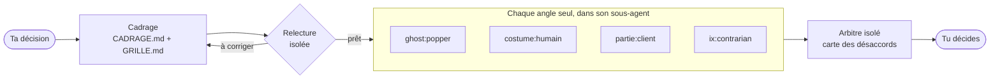

<p align="center">
  
</p>

<p align="center">
  <a href="LICENSE"></a>
  
  
  
  
  
</p>

<p align="center">
  <a href="#démarrage-rapide"><b>Démarrage rapide</b></a> ·
  <a href="docs/council/README.md"><b>Guide du conseil</b></a> ·
  <a href="#documentation"><b>Tous les skills</b></a> ·
  <a href="https://github.com/amiel-35/ghost-council/issues"><b>Signaler un problème</b></a> ·
  <a href="README.md"><b>English</b></a>
</p>

---

<details>
<summary><b>Sommaire</b></summary>

- [À propos](#à-propos)
- [Démarrage rapide](#démarrage-rapide)
- [Les ghosts](#les-ghosts)
- [Le conseil](#le-conseil)
- [Projet frère : ix-skills](#projet-frère--ix-skills)
- [Feuille de route](#feuille-de-route)
- [Contribuer](#contribuer)
- [Licence](#licence)
- [Remerciements](#remerciements)
- [Documentation](#documentation)

</details>

## À propos

Socrate, Popper, Wittgenstein, Sartre et quelques autres, encodés comme skills. Sans costume. Juste la méthode.

Ces gens n'avaient pas que des opinions, ils avaient des *méthodes*. Popper cherche systématiquement comment invalider une hypothèse. Wittgenstein refuse d'avancer tant qu'un terme n'est pas proprement défini. Sartre détecte la mauvaise foi, la façon dont on déguise ses choix en contraintes subies. Socrate pose des questions jusqu'à ce que la contradiction apparaisse.

Le problème des « agents philosophiques » habituels, c'est qu'ils encodent le personnage, pas la méthode : un prompt « tu es Kant » active de la biographie et des associations floues. Ici, chaque skill encode **une opération** applicable à un texte, une décision, un brief ou n'importe quel problème.

Ce dépôt est un seul plugin Claude Code, qui contient trois choses :

| | Ce que c'est | Où |
|---|---|---|
| **Les ghosts** | 23 méthodes de philosophes, plus Zeus, un arbitre | [Les ghosts](#les-ghosts) |
| **Le conseil** | `/council` fait délibérer des méthodes et d'autres angles sur une décision, puis rend la carte des désaccords | [Le conseil](#le-conseil), [guide complet](docs/council/README.md) |
| **doc-skill** | un outil pour les contributeurs, qui écrit la doc FR et EN d'un skill | [skills/doc-skill](skills/doc-skill/SKILL.md) |

## Démarrage rapide

Installer le plugin :

```bash
claude plugin marketplace add amiel-35/ghost-council
claude plugin install ghost-council@ghost-council
```

Redémarre Claude Code, puis demande simplement :

- *« Applique Popper à ce plan : qu'est-ce qui le réfuterait ? »*
- *« Passe ce brief à Wittgenstein : quels termes ne sont pas définis ? »*
- *« Fais délibérer un conseil : faut-il lancer une offre payante ce trimestre ? »*

Pour le conseil, installer aussi le plugin frère [ix-skills](https://github.com/amiel-35/ix-skills) (facultatif, recommandé), dont les postures de raisonnement peuvent y siéger :

```bash
claude plugin marketplace add amiel-35/ix-skills
claude plugin install ix-skills@ix-skills
```

Les plugins de l'auteur (ix-skills, ix-recipes, ghost-council) sont aussi réunis dans une seule marketplace, [amiel-35/plugins](https://github.com/amiel-35/plugins) : `claude plugin marketplace add amiel-35/plugins`, puis `claude plugin install ghost-council@amiel-35`. Installer un plugin depuis une seule marketplace ; le conseil trouve ix-skills dans les deux cas.

Pour mettre à jour : `claude plugin marketplace update ghost-council`, puis `claude plugin update ghost-council@ghost-council`. Sans plugin, copier un dossier `skills/<nom>/` dans `~/.claude/skills/` ; les ghosts sont du markdown pur et marchent aussi avec d'autres assistants.

## Les ghosts

**Solides** : la méthode se formalise bien.
Socrate, Platon, Aristote, Descartes, Popper, Wittgenstein, Hegel, Kant, Pascal, Épictète, Rawls, William James, Adam Smith, Montesquieu, Tocqueville, Nash

**Fun** : posture forte, formalisation partielle.
Nietzsche, Machiavel, Freud, Darwin, Sun Tzu, Sartre, Marx

**Arbitre** : pas de méthode propre, tranche entre les autres.
Zeus

Chaque ghost suit la même structure dans `skills/<nom>/SKILL.md` : **rôle** (l'opération concrète), **règles absolues** (ce que la méthode ne négocie pas), **méthode** (les étapes en verbes d'action), **output attendu**, **limites connues**. Une fiche par ghost dans le [tableau de documentation](#documentation).

> [!WARNING]
> Ce projet ne prétend pas être sérieux. Les skills sont **volontairement réducteurs** : encoder Kant en dix verbes d'action, c'est trahir Kant. On le sait, c'est fait exprès. Philosophes et enseignants sont les bienvenus pour critiquer ou corriger les contresens : les issues et les PR sont ouvertes pour ça.

## Le conseil

`/council` fait délibérer plusieurs angles **indépendants** sur une décision pas encore prise. Chaque angle travaille seul, en contexte vierge, sans lire les autres ni savoir ce que tu espères. Un arbitre isolé rend ensuite ce qui converge, ce qui s'oppose et pourquoi, ce qu'aucun n'a regardé, et la question qui reste à trancher. **Le conseil ne tranche pas : c'est toi qui décides.**



**Cinq familles d'angles**, à mélanger :

| Famille | Exemple | Ce que c'est |
|---|---|---|
| `ghost:` | `ghost:popper` | une méthode philosophique de ce dépôt |
| `ix:` | `ix:dixieme-homme` | une posture de raisonnement d'[ix-skills](https://github.com/amiel-35/ix-skills) |
| `costume:` | `costume:humain` | une dimension métier qu'on risque d'oublier : financier, commercial, produit, marque, technique, humain, juridique |
| `partie:` | `partie:client` | une partie prenante de cette décision, avec une fiche écrite pour la séance |
| `file:` | `file:<chemin>` | n'importe quel SKILL.md à toi |

**Trois formats** : `tour` (avis en parallèle, puis arbitre), `compare` (deux angles côte à côte), `deliberation` (dossier commun, vérificateur, deux tours et un vote). **Arbitre** : neutre par défaut, ou adversarial, Zeus, Nash, Aristote. **Un modèle par siège** si tu veux. Un script Python sans dépendance tient la paperasse de séance et contrôle le processus ; il n'appelle aucun modèle.

> [!NOTE]
> Expérimental. Les avis sont simulés : ils éclairent une décision, ils n'engagent personne et ne remplacent pas un expert réel.

**→ [Le guide complet du conseil](docs/council/README.md)** : installation, séance pas à pas, définition détaillée de chaque costume et des fiches de parties, formats, arbitres, cadrage, fichiers, script, questions fréquentes.

## Projet frère : ix-skills

[ix-skills](https://github.com/amiel-35/ix-skills) est l'autre collection du même auteur : des skills de travail (cadrage, critique, décision, vérification des faits, synthèse…) et des postures de raisonnement (dixième homme, contrarian, red team, premiers principes…). ghost-council encode des méthodes de pensée, ix-skills des gestes de travail ; `/council` les fait siéger côte à côte.

## Feuille de route

- [x] `/council`, avec les formats `compare` et `deliberation`
- [x] Cadrage préparé, relecture isolée, sièges de parties prenantes
- [ ] Une section « ce qui compte pour le décideur », lue par l'arbitre
- [ ] Un format `revue` : évaluation croisée anonymisée des avis
- [ ] Les améliorations repérées en séance : un vote léger en `tour`, les séances de suivi
- [ ] `/suggest` (quels ghosts pour ce problème ?) et `/evaluate` (un output a-t-il suivi la méthode ?)
- [ ] De nouveaux esprits : Taleb, Munger, Kahneman, Arendt, Bourdieu, Feynman…
- [ ] Une installation plus simple hors de Claude Code (Gemini CLI, GPT personnalisés)

Le détail dans [TODO.md](TODO.md).

## Contribuer

**Critère d'entrée d'un ghost** : une méthode qui s'écrit en verbes d'action concrets. Si tu ne peux pas écrire la section « Méthode », le philosophe n'est probablement pas dans le scope. Voir le [guide pour écrire un skill](docs/guide-ecrire-un-skill.md).

**Mainteneurs** : `skills/` est la source de vérité ; `dist/` est généré pour le plugin. Après toute modification dans `skills/`, lancer `python3 build.py`. Tests du conseil, depuis la racine du dépôt : `uvx pytest tests/` (ou `python3 -m pytest tests/`).

## Licence

MIT, voir [LICENSE](LICENSE). Une partie du script du conseil, de ses gabarits et de ses guides est adaptée d'un projet tiers sous licence MIT, voir [THIRD_PARTY.md](THIRD_PARTY.md).

## Remerciements

- [advisory-council](https://github.com/nzanepro/tvr-skills-agent-advisory-council) de nzanepro : la base du script du conseil, de son dossier commun, de son vérificateur et de son second tour.
- [llm-council](https://github.com/karpathy/llm-council) d'Andrej Karpathy : la délibération entre plusieurs modèles.
- [Improving Factuality and Reasoning in Language Models through Multiagent Debate](https://arxiv.org/abs/2305.14325) (Du et al., 2023).

## Documentation

| Skill | Catégorie | Description | Doc FR | Doc EN |
|-------|-----------|-------------|--------|--------|
| Socrate | Solide | Fait émerger les contradictions par questionnement systématique | [FR](docs/fr/socrate.md) | [EN](docs/en/socrate.md) |
| Platon | Solide | Remonte du concret vers la forme idéale avec sa dimension normative | [FR](docs/fr/platon.md) | [EN](docs/en/platon.md) |
| Aristote | Solide | Observe, classe, puis théorise — empirisme bottom-up | [FR](docs/fr/aristote.md) | [EN](docs/en/aristote.md) |
| Descartes | Solide | Rend explicites les hypothèses implicites avant toute décision | [FR](docs/fr/descartes.md) | [EN](docs/en/descartes.md) |
| Kant | Solide | Évalue une décision à l'aune de l'impératif catégorique | [FR](docs/fr/kant.md) | [EN](docs/en/kant.md) |
| Popper | Solide | Cherche à invalider plutôt qu'à confirmer une hypothèse | [FR](docs/fr/popper.md) | [EN](docs/en/popper.md) |
| Wittgenstein | Solide | Dissout les pseudo-problèmes par la clarté du langage | [FR](docs/fr/wittgenstein.md) | [EN](docs/en/wittgenstein.md) |
| Hegel | Solide | Construit une synthèse qui dépasse la tension entre deux positions | [FR](docs/fr/hegel.md) | [EN](docs/en/hegel.md) |
| Pascal | Solide | Risk assessment fondé sur l'asymétrie des enjeux sous incertitude | [FR](docs/fr/pascal.md) | [EN](docs/en/pascal.md) |
| Épictète | Solide | Coupe ce qui est en ton pouvoir de ce qui ne l'est pas | [FR](docs/fr/epictete.md) | [EN](docs/en/epictete.md) |
| Rawls | Solide | Évalue une règle depuis la position la plus défavorisée | [FR](docs/fr/rawls.md) | [EN](docs/en/rawls.md) |
| William James | Solide | Court-circuite les débats abstraits par la différence pratique | [FR](docs/fr/william-james.md) | [EN](docs/en/william-james.md) |
| Adam Smith | Solide | Identifie les mécanismes d'incentives qui produisent les comportements | [FR](docs/fr/adam-smith.md) | [EN](docs/en/adam-smith.md) |
| Montesquieu | Solide | Vérifie si une règle est adaptée à son contexte réel | [FR](docs/fr/montesquieu.md) | [EN](docs/en/montesquieu.md) |
| Tocqueville | Solide | Identifie les tensions structurelles et leurs trajectoires longues | [FR](docs/fr/tocqueville.md) | [EN](docs/en/tocqueville.md) |
| Nietzsche | Fun | Trace la généalogie des valeurs pour révéler les intérêts masqués | [FR](docs/fr/nietzsche.md) | [EN](docs/en/nietzsche.md) |
| Machiavel | Fun | Cartographie les rapports de force réels sans les gants | [FR](docs/fr/machiavel.md) | [EN](docs/en/machiavel.md) |
| Freud | Fun | Lit ce qui est voulu derrière ce qui est dit | [FR](docs/fr/freud.md) | [EN](docs/en/freud.md) |
| Darwin | Fun | Analyse ce qui survit dans un environnement de sélection donné | [FR](docs/fr/darwin.md) | [EN](docs/en/darwin.md) |
| Sun Tzu | Fun | Trouve l'asymétrie plutôt qu'attaquer frontalement | [FR](docs/fr/sun-tzu.md) | [EN](docs/en/sun-tzu.md) |
| Sartre | Fun | Détecte la mauvaise foi et retourne les pseudo-contraintes | [FR](docs/fr/sartre.md) | [EN](docs/en/sartre.md) |
| Marx | Fun | Lit les rapports de domination derrière les discours d'intérêt universel | [FR](docs/fr/marx.md) | [EN](docs/en/marx.md) |
| Nash | Solide | Modélise une situation comme un jeu, cherche l'équilibre de Nash et son écart à l'optimum collectif | [FR](docs/fr/nash.md) | [EN](docs/en/nash.md) |
| Zeus | Arbitre | Arbitre les outputs du conseil : convergences, contradictions irréductibles, tranche | [FR](docs/fr/zeus.md) | [EN](docs/en/zeus.md) |
| council | Conseil | Fait délibérer des angles indépendants, rend la carte des désaccords | [FR](docs/fr/council.md) | [EN](docs/en/council.md) |
