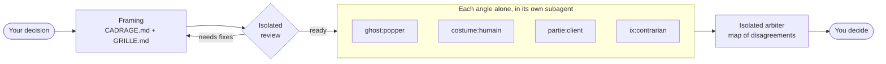

<p align="center">
  
</p>

<p align="center">
  <a href="LICENSE"></a>
  
  
  
  
  
</p>

<p align="center">
  <a href="#quick-start"><b>Quick start</b></a> ·
  <a href="docs/council/README.en.md"><b>Council guide</b></a> ·
  <a href="#documentation"><b>All skills</b></a> ·
  <a href="https://github.com/amiel-35/ghost-council/issues"><b>Report an issue</b></a> ·
  <a href="README.fr.md"><b>Français</b></a>
</p>

---

<details>
<summary><b>Table of contents</b></summary>

- [About](#about)
- [Quick start](#quick-start)
- [The ghosts](#the-ghosts)
- [The council](#the-council)
- [Sibling project: ix-skills](#sibling-project-ix-skills)
- [Roadmap](#roadmap)
- [Contributing](#contributing)
- [License](#license)
- [Acknowledgments](#acknowledgments)
- [Documentation](#documentation)

</details>

## About

Socrates, Popper, Wittgenstein, Sartre and a few others, encoded as skills. No costume. Just the method.

These people didn't just have opinions, they had *methods*. Popper systematically looks for ways to invalidate a hypothesis. Wittgenstein refuses to move forward until every term is properly defined. Sartre detects bad faith, the way we disguise our own choices as constraints. Socrates keeps asking questions until the contradiction surfaces.

The problem with most "philosophical agents" is that they encode the character, not the method: a "you are Kant" prompt activates biography and fuzzy associations. Here, each skill encodes **one operation** you can run on a text, a decision, a brief or any problem.

This repository is one Claude Code plugin holding three things:

| | What it is | Where |
|---|---|---|
| **The ghosts** | 23 philosophers' methods, plus Zeus, an arbiter | [The ghosts](#the-ghosts) |
| **The council** | `/council` makes methods and other angles deliberate on a decision, then returns the map of disagreements | [The council](#the-council), [full guide](docs/council/README.en.md) |
| **doc-skill** | a contributor tool that writes a skill's FR and EN documentation | [skills/doc-skill](skills/doc-skill/SKILL.md) |

## Quick start

Install the plugin:

```bash
claude plugin marketplace add amiel-35/ghost-council
claude plugin install ghost-council
```

Restart Claude Code, then just ask:

- *"Apply Popper to this plan: what would prove it wrong?"*
- *"Use Wittgenstein on this brief: which terms are undefined?"*
- *"Run a council on this decision: should we launch a paid tier this quarter?"*

For the council, also install the sibling plugin [ix-skills](https://github.com/amiel-35/ix-skills) (optional, recommended), whose reasoning postures can sit on it:

```bash
claude plugin marketplace add amiel-35/ix-skills
claude plugin install ix-skills
```

To update later: `claude plugin marketplace update ghost-council`, then `claude plugin update ghost-council`. Without the plugin, copy a `skills/<name>/` folder into `~/.claude/skills/`; the ghosts are plain markdown and also work with other assistants.

## The ghosts

**Solid**: the method formalizes well.
Socrates, Plato, Aristotle, Descartes, Popper, Wittgenstein, Hegel, Kant, Pascal, Epictetus, Rawls, William James, Adam Smith, Montesquieu, Tocqueville, Nash

**Fun**: strong posture, partial formalization.
Nietzsche, Machiavelli, Freud, Darwin, Sun Tzu, Sartre, Marx

**Arbiter**: no method of its own, settles between the others.
Zeus

Every ghost follows the same structure in `skills/<name>/SKILL.md`: **role** (the concrete operation), **absolute rules** (what the method doesn't negotiate), **method** (steps as action verbs), **expected output**, **known limits**. One page per ghost in the [documentation table](#documentation).

> [!WARNING]
> This project does not take itself seriously. The skills are **deliberately reductive**: encoding Kant in ten action verbs betrays Kant. We know. It's intentional. Philosophers and teachers are welcome to criticize or fix misrepresentations: issues and PRs are open for that.

## The council

`/council` makes several **independent** angles deliberate on a decision not yet taken. Each angle works alone, in a fresh context, without reading the others or knowing what you hope for. An isolated arbiter then returns what converges, what clashes and why, what nobody looked at, and the question left to settle. **The council doesn't decide: you do.**



**Five families of angles**, to be mixed:

| Family | Example | What it is |
|---|---|---|
| `ghost:` | `ghost:popper` | a philosophical method from this repo |
| `ix:` | `ix:dixieme-homme` | a reasoning posture from [ix-skills](https://github.com/amiel-35/ix-skills) |
| `costume:` | `costume:humain` | a business dimension that's easy to forget: finance, sales, product, brand, tech, people, legal |
| `partie:` | `partie:client` | a stakeholder in this decision, with a card written for the session |
| `file:` | `file:<path>` | any SKILL.md of your own |

**Three formats**: `tour` (parallel opinions, then the arbiter), `compare` (two angles side by side), `deliberation` (shared dossier, fact-checker, two rounds and a vote). **Arbiter**: neutral by default, or adversarial, Zeus, Nash, Aristotle. **One model per seat** if you want. A dependency-free Python script keeps the session paperwork and checks the process; it calls no model.

> [!NOTE]
> Experimental. The opinions are simulated: they inform a decision, they commit no one, and they don't replace a real expert. The skill itself is written in French.

**→ [The full council guide](docs/council/README.en.md)**: installation, a session step by step, detailed definitions of every costume and of stakeholder cards, formats, arbiters, framing, files, script, FAQ.

## Sibling project: ix-skills

[ix-skills](https://github.com/amiel-35/ix-skills) is the author's other collection: working skills (scoping, critique, decision, contract review, synthesis…) and reasoning postures (tenth man, contrarian, red team, first principles…). ghost-council encodes ways of thinking, ix-skills ways of working; `/council` seats them side by side.

## Roadmap

- [x] `/council`, with `compare` and `deliberation` formats
- [x] Prepared framing, isolated review, stakeholder seats
- [ ] A "what matters to the decision owner" section, read by the arbiter
- [ ] A `revue` format: anonymized cross-review of the opinions
- [ ] Council refinements spotted in real sessions: a light vote in `tour`, follow-up sessions
- [ ] `/suggest` (which ghosts for this problem?) and `/evaluate` (did an output follow the method?)
- [ ] New minds: Taleb, Munger, Kahneman, Arendt, Bourdieu, Feynman…
- [ ] Easier install outside Claude Code (Gemini CLI, custom GPTs)

Details in [TODO.md](TODO.md).

## Contributing

**Entry criterion for a ghost**: a method that can be written as concrete action verbs. If you can't write the "Method" section, the philosopher is probably out of scope. See the [guide to writing a skill](docs/guide-ecrire-un-skill.md#writing-a-skill-for-ghost-council).

**Maintainers**: `skills/` is the source of truth; `dist/` is generated for the plugin. After any change under `skills/`, run `python3 build.py`. Council tests, from the repository root: `uvx pytest tests/` (or `python3 -m pytest tests/`).

## License

MIT, see [LICENSE](LICENSE). Parts of the council script, its templates and guides are adapted from a third-party MIT project, see [THIRD_PARTY.md](THIRD_PARTY.md).

## Acknowledgments

- [advisory-council](https://github.com/nzanepro/tvr-skills-agent-advisory-council) by nzanepro: the base of the council script, its shared dossier, fact-checker and second round.
- [llm-council](https://github.com/karpathy/llm-council) by Andrej Karpathy: multi-model deliberation.
- [Improving Factuality and Reasoning in Language Models through Multiagent Debate](https://arxiv.org/abs/2305.14325) (Du et al., 2023).

## Documentation

| Skill | Category | Description | Doc FR | Doc EN |
|-------|----------|-------------|--------|--------|
| Socrates | Solid | Surfaces contradictions through systematic questioning | [FR](docs/fr/socrate.md) | [EN](docs/en/socrate.md) |
| Plato | Solid | Ascends from instances to the ideal form with normative dimension | [FR](docs/fr/platon.md) | [EN](docs/en/platon.md) |
| Aristotle | Solid | Observes, classifies, then theorizes — systematic bottom-up | [FR](docs/fr/aristote.md) | [EN](docs/en/aristote.md) |
| Descartes | Solid | Makes implicit assumptions explicit before any decision | [FR](docs/fr/descartes.md) | [EN](docs/en/descartes.md) |
| Kant | Solid | Evaluates decisions through the categorical imperative | [FR](docs/fr/kant.md) | [EN](docs/en/kant.md) |
| Popper | Solid | Seeks to falsify rather than confirm a hypothesis | [FR](docs/fr/popper.md) | [EN](docs/en/popper.md) |
| Wittgenstein | Solid | Dissolves pseudo-problems through language clarity | [FR](docs/fr/wittgenstein.md) | [EN](docs/en/wittgenstein.md) |
| Hegel | Solid | Builds a synthesis that transcends tension between two positions | [FR](docs/fr/hegel.md) | [EN](docs/en/hegel.md) |
| Pascal | Solid | Risk assessment based on stakes asymmetry under uncertainty | [FR](docs/fr/pascal.md) | [EN](docs/en/pascal.md) |
| Epictetus | Solid | Separates what is in your control from what is not | [FR](docs/fr/epictete.md) | [EN](docs/en/epictete.md) |
| Rawls | Solid | Evaluates a rule from the least advantaged position | [FR](docs/fr/rawls.md) | [EN](docs/en/rawls.md) |
| William James | Solid | Short-circuits abstract debates with the practical difference test | [FR](docs/fr/william-james.md) | [EN](docs/en/william-james.md) |
| Adam Smith | Solid | Identifies incentive mechanisms that produce observed behaviors | [FR](docs/fr/adam-smith.md) | [EN](docs/en/adam-smith.md) |
| Montesquieu | Solid | Checks whether a rule is adapted to its actual context | [FR](docs/fr/montesquieu.md) | [EN](docs/en/montesquieu.md) |
| Tocqueville | Solid | Identifies structural tensions and their long-term trajectories | [FR](docs/fr/tocqueville.md) | [EN](docs/en/tocqueville.md) |
| Nietzsche | Fun | Traces the genealogy of values to reveal masked interests | [FR](docs/fr/nietzsche.md) | [EN](docs/en/nietzsche.md) |
| Machiavelli | Fun | Maps real power dynamics without the gloves | [FR](docs/fr/machiavel.md) | [EN](docs/en/machiavel.md) |
| Freud | Fun | Reads what is wanted behind what is said | [FR](docs/fr/freud.md) | [EN](docs/en/freud.md) |
| Darwin | Fun | Analyzes what survives in a given selection environment | [FR](docs/fr/darwin.md) | [EN](docs/en/darwin.md) |
| Sun Tzu | Fun | Finds the asymmetry rather than attacking head-on | [FR](docs/fr/sun-tzu.md) | [EN](docs/en/sun-tzu.md) |
| Sartre | Fun | Detects bad faith and reverses pseudo-constraints | [FR](docs/fr/sartre.md) | [EN](docs/en/sartre.md) |
| Marx | Fun | Reads domination relations behind universal interest discourses | [FR](docs/fr/marx.md) | [EN](docs/en/marx.md) |
| Nash | Solid | Models a situation as a game, finds the Nash equilibrium and its gap to the collective optimum | [FR](docs/fr/nash.md) | [EN](docs/en/nash.md) |
| Zeus | Arbiter | Arbitrates council outputs: convergences, irreducible contradictions, rules on the question | [FR](docs/fr/zeus.md) | [EN](docs/en/zeus.md) |
| council | Council | Makes independent angles deliberate, returns the map of disagreements | [FR](docs/fr/council.md) | [EN](docs/en/council.md) |
